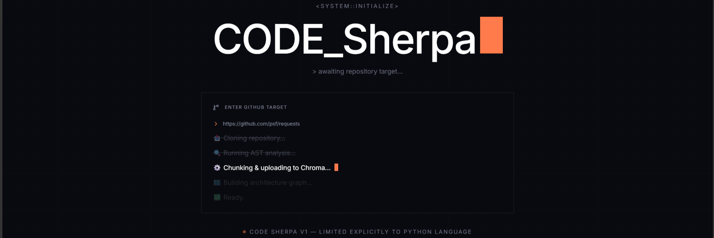
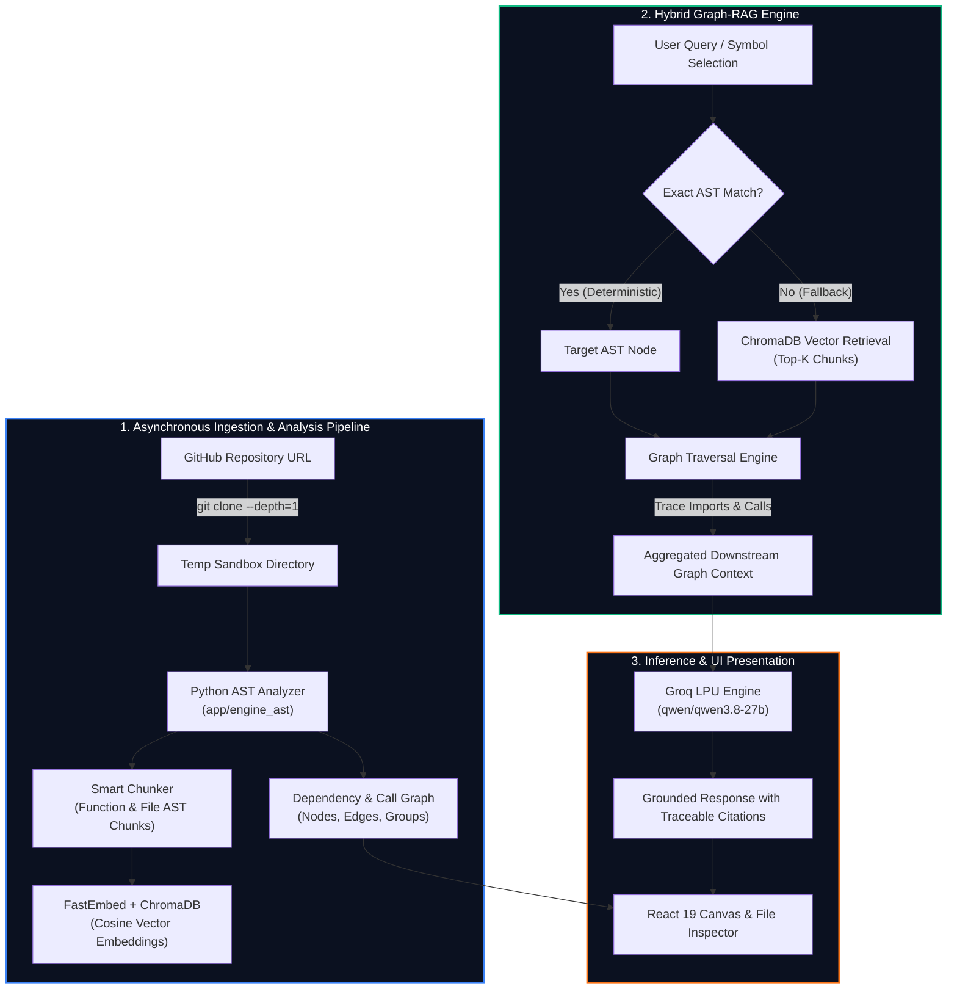

# CODE Sherpa 🧭

<div align="center">



### **Interactive Codebase Architecture Visualizer & Hybrid Graph-RAG Engine**

*Understand complex codebases through interactive dependency graphs, deterministic AST parsing, and precision-grounded AI explanation.*

[](https://code-sherpa-sajv.onrender.com)

[](./LICENSE)
[](https://www.python.org/)
[](https://fastapi.tiangolo.com/)
[](https://react.dev/)
[](https://vitejs.dev/)
[](https://www.trychroma.com/)
[](https://groq.com/)

**Developed by [Sarthak Bhatt](https://github.com/S-2007)**

---

</div>

## 📌 Executive Summary

Modern AI code assistants rely primarily on **semantic vector similarity** (naive RAG). While effective for natural language, semantic search often fails on source code because it lacks structural understanding: it cannot deterministically trace imports, verify caller-callee relationships, or prove that a symbol belongs to a specific module.

**CODE Sherpa** bridges this gap by combining **Deterministic Abstract Syntax Tree (AST) Extraction** with a **Hybrid Graph-RAG Retrieval Pipeline**:
1. **Parses repository structure into an explicit knowledge graph** of modules, functions, classes, imports, and cross-file calls without executing repository code.
2. **Prioritizes deterministic symbol matching** before falling back to cosine semantic similarity in ChromaDB.
3. **Retrieves focused functional chunks** along with immediate downstream call context, slashing LLM prompt token costs by **44.7%** on function-level questions and **23.2%** overall compared to whole-file injection.
4. **Visualizes codebase topography** through a real-time, interactive, multi-layer canvas with interactive code inspection and citation tracking.

---

## 📊 Measured Benchmark Results

Evaluated against an empirical 30-query benchmark across production Python repositories using `tiktoken` (`cl100k_base`):

| Evaluation Metric | Sherpa Result | Baseline (Full Relevant Files) | Engineering Impact |
| :--- | :---: | :---: | :--- |
| **Function-Level Queries (15 queries)** | **44.7% fewer prompt tokens** | 100% full-file baseline | Eliminates dead code noise; isolates targeted function blocks |
| **Mixed Workload (30 queries)** | **23.2% fewer prompt tokens** | 100% full-file baseline | Net savings on 18 of 30 queries across broad and narrow tasks |
| **Local Vector Retrieval Latency** | **0.12 s average** | Standard remote vector APIs | Sub-second local retrieval via embedded persistent ChromaDB |
| **LLM Inference Speed** | **Ultra-low latency** | Standard cloud APIs | Accelerated through Groq LPUs (`qwen/qwen3.8-27b`) |

> *Benchmark scripts, raw measurements, and reproducible datasets are available in [`bm_tokens_v2.py`](./bm_tokens_v2.py), [`bm_tokens_v2.csv`](./bm_tokens_v2.csv), [`bm_latency_v2.py`](./bm_latency_v2.py), and [`queries.txt`](./queries.txt).*

---

## 🏗️ System Architecture



---

## ✨ Key Technical Features

### 1. Interactive Architectural Dependency Graph
- **Topological Grid Layout:** Automatically stratifies codebase layers into structured, readable multi-row rows based on container bounds.
- **Dynamic Viewport Auto-Centering:** Self-calculating bounding boxes ensure zero-clipping of nodes on mount, resize, and chat panel toggles.
- **Fluid Canvas Interaction:** Smooth canvas panning, mouse wheel scrolling, `Ctrl + Wheel` zooming, and drag-and-drop node positioning.
- **Collapsible Workspace Panels:** Expand graph space with a one-click hideable chat drawer while preserving chat memory.

### 2. Dual-Engine Hybrid Retrieval (Graph + Vector)
- **Deterministic First:** Resolves module paths (`src/requests/adapters.py`) and symbol references before spending embedding computations.
- **Call-Chain Context Injection:** Follows outgoing and incoming edges to supply downstream function dependencies directly into prompt context.
- **Local Embedded Fallback:** Automatic zero-config fallback to disk-persisted Chroma collections (`chroma_data/`) when cloud vector credentials are not supplied.

### 3. Traceable Code Citations & Function Inspection
- Every generated answer includes node-level citation badges (e.g., `[src.requests.models]`).
- Clicking citations or graph nodes instantly opens the **Function View**, loading source code highlighted via `highlight.js` with exact line number references.

### 4. Asynchronous Non-Blocking Ingestion
- Repository cloning and AST analysis execute inside FastAPI `BackgroundTasks`.
- Clients poll lightweight status endpoints with progressive telemetry (`cloning` ➔ `analyzing` ➔ `ready`).

---

## 💻 Tech Stack & Engineering Tools

| Domain | Technology | Purpose |
| :--- | :--- | :--- |
| **Frontend Framework** | **React 19, Vite 8** | High-performance reactive UI with instant Hot Module Replacement (HMR) |
| **Styling & Icons** | **TailwindCSS 4, Lucide React** | Industrial telemetry-inspired dark terminal theme (`JetBrains Mono` typography) |
| **Syntax Highlighting** | **Highlight.js** | Multi-language syntax parsing for in-browser function code inspection |
| **Backend Framework** | **FastAPI, Uvicorn** | High-concurrency async Python API with background worker queues |
| **AST Parsing** | **Python `ast` Standard Library** | Zero-dependency, static syntactic extraction of modules, functions, classes & calls |
| **Vector Database** | **ChromaDB, FastEmbed** | Dense vector index supporting cosine distance similarity with local persistence |
| **LLM Inference** | **Groq API (`qwen/qwen3.8-27b`)** | Lightning-fast token generation on custom LPU tensor architecture |
| **State Management** | **Zustand** | Centralized, decoupled client state for repository telemetry and chat buffers |

---

## 🌐 Live Deployment

CODE Sherpa is deployed live and fully functional:
👉 **[https://code-sherpa-sajv.onrender.com](https://code-sherpa-sajv.onrender.com)**

Paste any public Python GitHub repository (e.g., `https://github.com/psf/requests.git`) to visualize its architecture and ask questions.

---

## 🚀 Local Setup & Installation

### Prerequisites
- **Git** (CLI installed and configured in system PATH)
- **Python 3.10** or **3.11**
- **Node.js 18+** or **20+** with `npm`

---

### Step 1: Clone the Repository

```bash
git clone https://github.com/S-2007/Code-Sherpa.git
cd Code-Sherpa
```

---

### Step 2: Configure Environment Variables

Create a `.env` file in the root directory:

```dotenv
# Required: Groq API Key (Get free key at https://console.groq.com/keys)
GROQ_API_KEY=your_groq_api_key_here

# Active model for code analysis & chat
GROQ_MODEL=qwen/qwen3.8-27b

# Optional: Chroma Cloud (leave blank to run 100% offline via local ChromaDB)
CHROMA_API_KEY=
CHROMA_TENANT=
CHROMA_DATABASE=
```

---

### Step 3: Backend Setup

```bash
# 1. Install dependencies
pip install -r requirements.txt

# 2. Run the FastAPI development server
cd backend
python -m uvicorn app.server:app --reload --port 8000
```
> The API will be active at `http://127.0.0.1:8000`.

---

### Step 4: Frontend Setup

In a new terminal window:

```bash
# 1. Navigate to frontend directory
cd frontend

# 2. Install dependencies
npm install

# 3. Start Vite dev server
npm run dev
```
> Open your browser at **`http://localhost:5173`**.

---

## 🧪 Benchmarks & Quality Verification

To replicate the empirical measurements locally:

```bash
# Verify local chunking and vector retrieval
python tests/verify.py

# Run token savings benchmark (uses tiktoken cl100k_base)
python bm_tokens_v2.py

# Run retrieval latency benchmark
python bm_latency_v2.py
```

---

## 🛣️ Roadmap & Future Enhancements

- [ ] **Multi-Language AST:** Integrate Tree-sitter parsers to support TypeScript, Go, and Rust repositories.
- [ ] **Multi-Hop Call Tracing:** Interactive graphical path-finding between arbitrary start and target functions.
- [ ] **Multi-Tenant Session Isolation:** Namespaced collection partitioning for concurrent multi-user analysis.

---

## 📜 License

Distributed under the **Apache License 2.0**. See [`LICENSE`](./LICENSE) for full legal text.

---

<div align="center">

**Developed with ❤️ by [Sarthak Bhatt](https://github.com/S-2007)**  
*Contributions, issues, and feature suggestions are welcome!*

</div>
